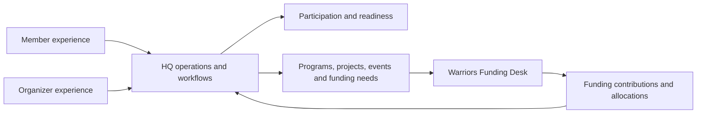

# Hudson Valley Warriors HQ

**Flagship project 1 · Operational product architecture and workflow integration**

An independent, AI-assisted Base44 application that connects member participation, program operations, equipment readiness, and funding needs in one operational workspace.

## The problem I designed around

Community programs require more than a contact list or calendar. A participant may need access approval, current paperwork, equipment, and program-specific readiness before an event. Organizers also need to understand what a program requires, what it costs, and where funding is missing.

I designed HQ around those relationships: people participate in programs and events; programs need resources; resources generate costs and funding needs. The goal was to make the next operational action visible within that connected model.

This case study describes product design and implemented application behavior. It does not claim measured organizational savings, adoption, or financial results.

## My role

I led the product definition and 0→1 application architecture: identifying operational objects, defining workflows and business rules, composing the member and operations experiences, and specifying how HQ connects with a separate funding workspace. I used Base44 and AI-assisted development to implement and iterate on the application.

The work demonstrates translating operational requirements into a working application structure. Base44 provides the underlying hosted platform, authentication, data services, and integration primitives. I do not present this as sole manual authorship of every line or as building that infrastructure from scratch.

## What I built

- Separate member and operations experiences, including member profiles, events, documents and equipment views.
- Operational workflows for programs, projects, people, events, equipment inventory and loans, tasks, partnerships and outreach.
- Readiness and acknowledgment workflows covering registration status, waivers, handbook versions, eligibility attestations and equipment needs.
- Funding-needs and budget views that distinguish planned cost, secured support, and cash received.
- A connection to Warriors Funding Desk, with source-record identity, field mapping, retry controls and funding reconciliation.
- An isolated demonstration mode designed to show connected workflows with sample records and blocked external side effects.

Some routes remain placeholders, including organizational documents, reports and member announcements. Broader live authorization and provider verification remain development work.

## Architecture and product decisions

**Separate operational needs from funding pursuit.** HQ is the source of operational Programs, Projects, Events and Funding Needs. Funding Desk handles discovery, pursuit and allocation. This separation lets each workspace answer a distinct question while sharing connected records.

**Preserve independent waiver confirmation.** Members can report submitting the fiscal-sponsor waiver through Veterans Collaborative. That report remains pending verification until an HVW admin or manager receives confirmation from Veterans Collaborative. Submission and staff verification are separate stages.

**Treat readiness as a workflow.** A single “active” flag cannot capture paperwork, registration, acknowledgment versions, equipment, and program requirements. I modeled those states separately so the product can explain what still needs attention. The application records status and attestations; it does not independently certify official credentials.

**Keep commitments and receipts separate.** An award or commitment is not the same as money received. The funding model preserves that distinction and calculates the remaining need without adding the same support twice.

**Recompute totals after changes.** Funding edits, allocation removals and repeated sync attempts should reconcile from records instead of incrementing an aggregate on every delivery. The shared workflow logic follows that approach.

**Create a controlled demonstration path.** Demo records and paired mode checks support showing cross-app behavior without treating sample activity as live operations. Regression tests check that selected demo calls cannot fall through to live email, upload, agent or account operations.

## A synthetic walkthrough

A sample equipment need totals **$5,410**. A contribution records **$5,000 committed** and **$4,000 received**. The workflow shows **$410 remaining against the commitment** and **$1,000 of the commitment still awaiting receipt**.

Those values are a test fixture, not actual fundraising results. The example demonstrates a business rule: support secured, cash received and unmet need answer different operational questions.

## Evidence and current status

In a November 2026 repository review, all four checked-in HQ regression files passed. They cover staff verification and member submission boundaries, budget/allocation calculations, demo-client routing, and paired demo workflows, including identity mapping, edits/removals, mode mismatch and repeated synchronization.

The tests use mocked services and synthetic records. They do not establish deployed authorization correctness, live provider connectivity, scale or production security. The application remains in development, with further permission hardening, end-to-end validation and operational documentation needed.

## What this project demonstrates

- Turning operational requirements into an application domain model.
- Designing workflows across member services, program readiness, equipment and budgets.
- Defining responsibilities and record ownership across two applications.
- Translating funding semantics into explicit calculations and regression scenarios.
- Using AI-assisted development while retaining responsibility for product decisions and validation limits.

The next phase is focused on authorization hardening, deployment-level verification, clearer runbooks and completing the remaining surfaces.

## About this repository

This is a documentation-only portfolio case study. Application source and operational records remain private. No member records, internal endpoints, credentials or real financial outcomes are included. No public demo access is provided here.

Companion case study: [Warriors Funding Desk](https://github.com/VeteranSystems/warriors-funding-desk-case-study).
